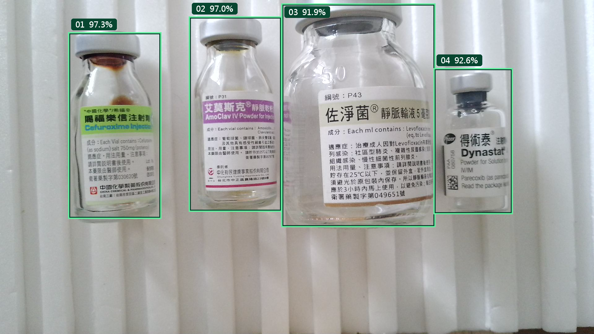
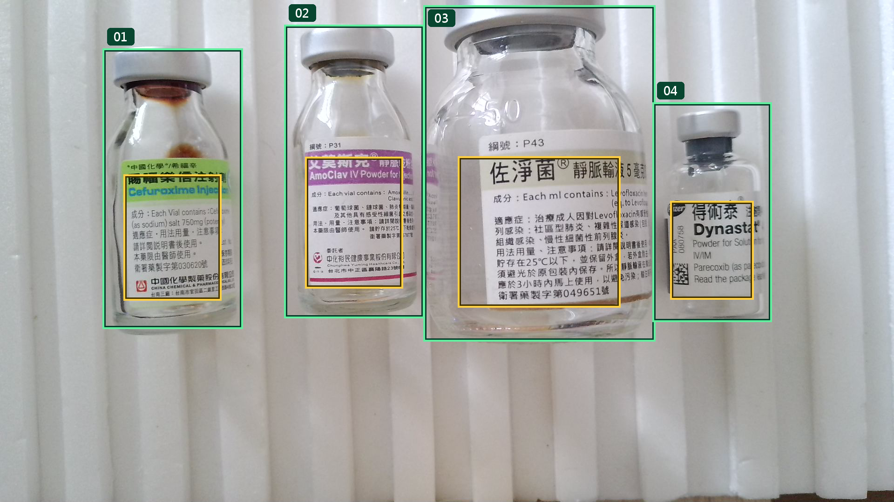
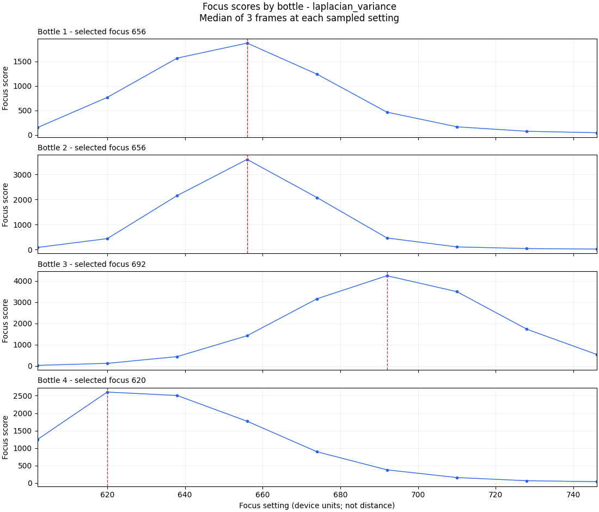
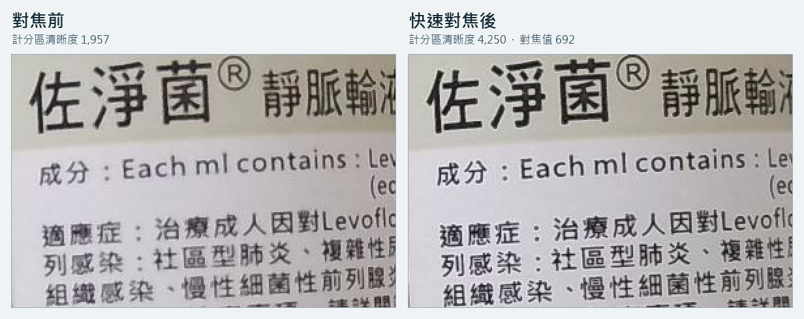
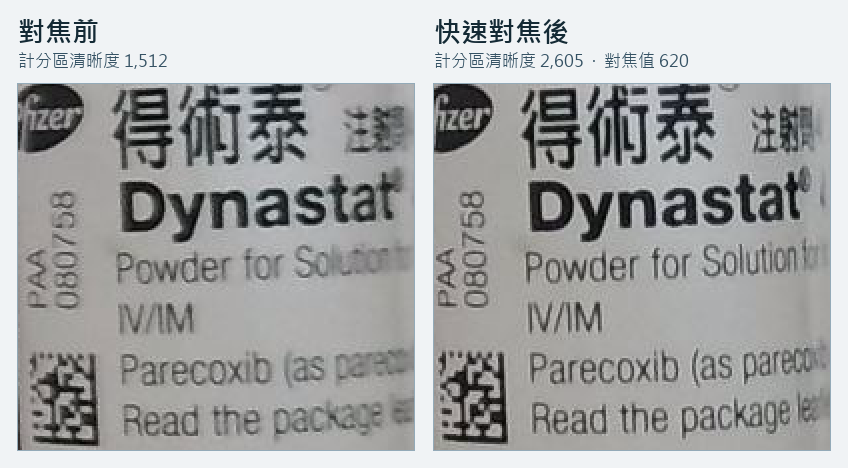
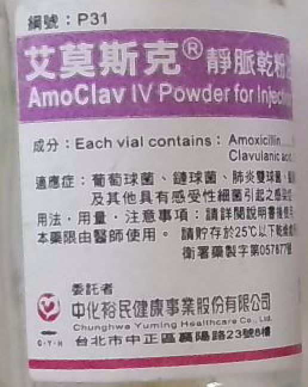

# 四瓶藥品快速對焦與辨識實測

2026 年 11 月 18 日｜投影片草稿

最新一輪沿用 YOLO11n 建立的四個瓶身 ROI。相機先自動對焦，再於讀回值附近試 **9 個焦點**。同一組影格讓四瓶共用，各瓶從中選出最清楚的照片。從開始自動對焦到**四張照片全部存完並還原相機，合計 4.40 秒**。之後用 PP-OCRv6 small 讀出 53 行文字，再用 SQLite 查詢四瓶。 [本輪對焦與存圖紀錄](runs/scan_20261118_121929_904595/focus_scan.json)

## 1. USB 相機如何調焦

本次使用 `Usb HDCamera`，輸出 **1920 × 1080**。Windows DirectShow 提供 `Focus` 控制，可以讀取目前設定、切換手動對焦並移動鏡頭的對焦機構。調整後，畫面中處於最清晰的位置會改變，因此同一畫面內不同瓶子可以分別找各自的最佳設定。

| 相機回報的參數 | 本次設定 |
| --- | --- |
| 可設定範圍 | 0–1023，步進 1 |
| 自動對焦後 | 等約 1.02 秒，讀回 `674` 作為搜尋中心 |
| 掃描期間 | 程式設定手動焦點，每次寫入後讀回確認 |
| 掃描完成 | 恢復原本的自動對焦模式 |

`674`、`656` 等數字是相機驅動回報的裝置刻度。要換算實際物距需另外校正。 [相機與對焦紀錄](runs/scan_20261118_121929_904595/focus_scan.json) · [Microsoft 相機對焦屬性](https://learn.microsoft.com/en-us/windows-hardware/drivers/stream/ksproperty-cameracontrol-focus)

## 2. YOLO11n 偵測藥瓶，建立 ROI

資料集共 50 張，分成 40 張訓練和 10 張驗證。使用 COCO 預訓練的 YOLO11n 做單類別藥瓶偵測，凍結前 10 個模組並使用小幅位置、角度和亮度增強。CPU 訓練在第 13 輪早停。本次採用 `last.pt`，在信心門檻 `0.40`、配對 IoU 至少 `0.50` 的條件下，10 個單瓶驗證框均命中。 [訓練與權重評估](runs/train_20261118_091451_575457/training_summary.json) · [Ultralytics YOLO11](https://docs.ultralytics.com/models/yolo11)

現場先將全景送入 YOLO11n（`imgsz=640`），把輸出的框轉回 1920 × 1080 的影像座標並保存。每個框是該瓶的 **ROI（感興趣區域）**，由左至右編為 1–4。最新的 4.40 秒複測沿用這組座標，四瓶和相機在拍攝期間保持固定。

**圖 1**　綠框依建立這組 ROI 時的實際 YOLO11n 輸出重繪。框上是瓶號與偵測信心，介於 **91.9%–97.3%**。 [原尺寸標框圖](report_assets/fast-autofocus/01-yolo-boxes.png) · [YOLO 定位紀錄](runs/scan_20261118_115809_002098/focus_scan.json) · [實拍沿用的 ROI 座標](runs/scan_20261118_121929_904595/roi_config.json)

若移動瓶子或相機，需重新建立 ROI。另有一張五瓶相鄰的舊畫面曾漏框一瓶，開始掃描前會確認框數與預期相符。 [實拍結果與限制](README.md#6-2026-11-18-這次實拍的結果)

## 3. 對焦演算法

本次採用 **Laplacian variance（拉普拉斯變異數）** 選焦。把計分區轉為灰階，用 Laplacian 取得文字筆畫、標籤邊界附近的明暗變化，計算該區像素反應的變異數。對同一瓶的固定區域，邊緣越銳利，通常分數越高。

| 清晰度指標 | 本次用途 |
| --- | --- |
| Laplacian variance | `Var(Laplacian(灰階圖))`，用來選擇焦點 |
| Tenengrad | `Mean(Gx² + Gy²)`，以 Sobel 梯度計算，同步留下分數供對照 |

**快速模式從自動對焦值開始，對附近 9 個焦點取樣。** 只比較同一瓶、同一塊標籤區在各焦點的分數。四瓶共用每個焦點的全景影格，但各自有一條分數曲線和一張選出的照片。 [計分程式](../focus_test/main.py#L79) · [掃描程式](../focus_test/focus_scan.py)

## 4. 如何把對焦演算法用到每瓶 ROI

**圖 2**　綠框是保存及 OCR 使用的完整瓶框。黃框取瓶框內水平 **15%–85%**、垂直 **45%–90%**，清晰度分數只在這塊固定的標籤區計算。 [原尺寸計分區示意圖](report_assets/fast-autofocus/02-focus-roi.png)

### 自動對焦起頭的五秒內模式

1. **讓相機自動對焦。** 約一秒後讀回焦點。這輪讀回 `674`。
2. **算出 9 個取樣點。** 在 `674` 前後各 72 刻度內搜尋，得到 `602–746`。把 144 刻度切成 8 段，每隔 18 刻度取一點，含兩端共 9 點。先量 `674`，再從 `602` 往上量其餘取樣點。
3. **四瓶共用每次取樣。** 設定焦點並確認相機讀回後，等 0.15 秒、丟 1 張影格，再取 3 張。每個 ROI 各自取分數中位數，分數波動過大的取樣點不參與選焦。
4. **直接存已拍到的最佳影格。** 各瓶挑分數最高的穩定取樣組，儲存該組的中位數影格和原尺寸 ROI。這樣可省下逐瓶移回最佳焦點重拍的時間。若最佳值落在搜尋邊界，標記為待核對。完成後還原相機設定。

**圖 3**　橫軸是鏡頭裝置刻度，縱軸是 Laplacian 分數。第 1、2 瓶都選到 `656`，第 3 瓶選到 `692`，第 4 瓶選到 `620`。 [原尺寸曲線](runs/scan_20261118_121929_904595/focus_curves.png) · [9 點取樣 CSV](runs/scan_20261118_121929_904595/focus_curve.csv)

| 快速模式輪次 | 自動對焦起點 | 設定焦點次數 | 四瓶合計對焦與存圖 |
| --- | ---: | ---: | ---: |
| 首輪（YOLO 定位） | 688 | 9 | 3.90 秒 |
| 複測一（沿用 23.1 秒法的 ROI） | 665 | 9 | 4.41 秒 |
| 複測二（沿用 23.1 秒法的 ROI） | 687 | 9 | 4.38 秒 |
| **最新複測（12:19，沿用同一組 ROI）** | **674** | **9** | **4.40 秒** |

四輪皆存完四張照片並通過焦點品質檢查。**4.40 秒從 ROI 已確定、開始自動對焦起算，直到四張存完且相機設定還原。** 相機冷啟動、YOLO 定位、曲線圖與 OCR 查詢另計。 [首輪紀錄](runs/scan_20261118_120631_437051/focus_scan.json) · [複測一](runs/scan_20261118_120731_705012/focus_scan.json) · [複測二](runs/scan_20261118_120740_153268/focus_scan.json) · [最新複測](runs/scan_20261118_121929_904595/focus_scan.json) · [操作手冊](README.md#用自動對焦起頭的快速模式)

### 歷次對焦方式比較

| 四瓶拍攝方式 | 取樣設定＋重拍 | 實測耗時 |
| --- | ---: | ---: |
| 初版逐瓶全範圍掃描 | 180＋4 | 102.1 秒 |
| 全範圍共用取樣，等待 0.35 秒 | 87＋4 | 52.5 秒 |
| 全範圍共用取樣，等待 0.20 秒 | 87＋4 | 40.9 秒 |
| 自動對焦後在附近細掃 | 49＋4 | 23.1 秒 |
| 從 655 開始細掃 600–710 | 49＋4 | 22.5 秒 |
| **快速模式，共用 9 點並直接存圖** | **9＋0** | **4.40 秒** |

使用同一組 ROI 的三次快速複測，Laplacian 分數相對於 23.1 秒細掃變動為 **−10.6% 至 +0.4%**。以相同 ROI 完成拍攝後，再對照片實跑 OCR 驗證辨識效果。 [23.1 秒細掃紀錄](runs/scan_20261118_115809_002098/focus_scan.json) · [22.5 秒固定範圍紀錄](runs/scan_20261118_115919_954838/focus_scan.json)

## 5. 對焦前後的清晰度差別

「對焦前」取自 12:19 這輪開始快速搜尋前的全景，「對焦後」取自各瓶在 9 點搜尋中選到的影格。每瓶的前後分數都在同一組原圖座標計算。下方兩張對照圖各取完全相同的裁切位置，以 **2× 最近鄰** 放大。可開啟原尺寸照片逐字查看。

| 瓶號 | 最佳對焦值 | 對焦前 Laplacian | 對焦後 Laplacian | 同瓶分數變化 |
| --- | ---: | ---: | ---: | ---: |
| 01 賜福樂信 | 656 | 1,756.59 | 1,872.75 | +6.6% |
| 02 艾莫斯克 | 656 | 3,404.80 | 3,601.33 | +5.8% |
| **03 佐淨菌** | **692** | **1,957.48** | **4,249.68** | **+117.1%** |
| **04 得術泰** | **620** | **1,511.94** | **2,604.59** | **+72.3%** |

### 第 3 瓶佐淨菌

**圖 4**　看「成分」、`Each ml contains` 與「適應症」。右圖小字間的空隙和筆畫較容易分辨。圖中分數取自整個黃框計分區。 [開啟 2× 對照](report_assets/fast-autofocus/03-bottle3-comparison.png) · [對焦前原尺寸裁切](report_assets/fast-autofocus/bottle3-before-native.png) · [對焦後原尺寸裁切](runs/scan_20261118_121929_904595/rois/03.png) · [對焦後完整影格](runs/scan_20261118_121929_904595/frames/03.png)

### 第 4 瓶得術泰

**圖 5**　看 `Dynastat` 下方的 `Powder for Solution`、`IV/IM` 和左下角條碼。右圖細字與深淺交界較容易區分，靠瓶身右側的文字仍受到弧面影響。圖中分數取自整個黃框計分區。 [開啟 2× 對照](report_assets/fast-autofocus/04-bottle4-comparison.png) · [對焦前原尺寸裁切](report_assets/fast-autofocus/bottle4-before-native.png) · [對焦後原尺寸裁切](runs/scan_20261118_121929_904595/rois/04.png) · [對焦後完整影格](runs/scan_20261118_121929_904595/frames/04.png)

## 6. PP-OCRv6 small 與資料庫查詢結果

PP-OCRv6 small 用 `small_det` 找出瓶身上的文字區塊，再用 `small_rec` 讀出文字。下表使用 **4.40 秒那輪**直接保存的四張照片實跑，四瓶都得到文字結果，共 **53 行**。每行附文字座標與信心分數。 [PaddleOCR PP-OCRv6](https://www.paddleocr.ai/latest/en/version3.x/algorithm/PP-OCRv6/PP-OCRv6.html)

SQLite 查詢由 Python 固定規則執行，**沒有 LLM 參與**。先用帶 `藥製字` 或 `藥輸字` 的六位數字號，透過 `license_no` 索引精確查詢。如果字號缺少或查不到，才用信心分數至少 `0.80` 且符合文字規則的 OCR 行比對中、英文藥名開頭。名稱命中列為待核對候選，同字號的多筆資料會全部列出。 [查詢規則](lookup.py#L74)

| 瓶號 | OCR 行數 | PP-OCRv6 small 原文節錄 | 更新後的 SQLite 結果 |
| --- | ---: | --- | --- |
| 01 | 15 | `衛署藥製字第030620號` | 字號唯一命中賜福樂信注射劑 **750 mg** |
| 02 | 16 | `艾莫斯克` · `衛署藥製字第057877` | 同字號命中 **600 mg**、**1.2 g** 兩筆，待核規格 |
| 03 | 13 | `佐淨菌` · `衛署藥製字第049651號` | 字號唯一命中佐淨菌靜脈輸液 **5 mg/mL** |
| 04 | 9 | `得術泰` · `Dynastat` | 中英文命中同一筆名稱候選，資料庫規格 **40 mg** |

第 4 瓶的 `40 mg` 來自資料庫的候選列。部分弧面小字仍有缺字，例如第 2 瓶的英文品名只讀成 `AmoClav IV Powder for Injed`。 [本輪 OCR 完整結果](runs/scan_20261118_121929_904595/ocr/run_20261118_122714_233580/summary.json) · [本輪 SQLite 完整結果](runs/scan_20261118_121929_904595/ocr/run_20261118_122714_233580/lookup_20261118_122731_811274.json)

## 7. 例外案例　艾莫斯克 600 mg 與 1.2 g

**圖 6**　正面標籤可讀出「艾莫斯克」與藥證數字，成分欄右側轉入瓶身弧面。這次影像與 OCR 缺少可區分兩個規格的完整文字。 [原尺寸瓶圖](runs/scan_20261118_121929_904595/rois/02.png) · [對焦後完整影格](runs/scan_20261118_121929_904595/frames/02.png)

| 資料庫候選 | 藥證字號 | 規格 |
| --- | --- | --- |
| ID 414 艾莫斯克靜脈乾粉注射劑 | 衛署藥製字第057877號 | **600 mg** |
| ID 415 艾莫斯克靜脈乾粉注射劑 | 衛署藥製字第057877號 | **1.2 g** |

**對焦後已讀到品名和藥證字號。要辨識到單一規格，還需要拍到能區分候選的資訊。** 這一面拍到的品名與字號是兩筆資料共用的，所以系統保留兩筆並標示待核對。要確認實體是哪一種規格，可以轉瓶補拍規格字樣，或拍外盒上清楚標示的規格。若要由程式自動區分，還需將拍到的規格文字納入查詢比對。 [本輪 OCR 標記圖](runs/scan_20261118_121929_904595/ocr/run_20261118_122714_233580/bottle_02/annotated.png) · [兩筆候選的查詢紀錄](runs/scan_20261118_121929_904595/ocr/run_20261118_122714_233580/lookup_20261118_122731_811274.json)
